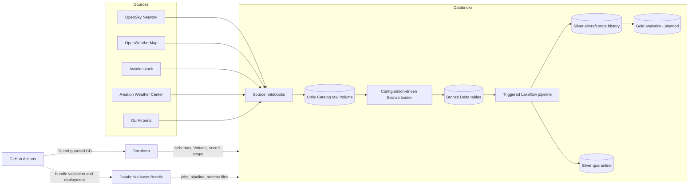

# AeroLakehouse Databricks

[](https://github.com/TalarGreg/aerolakehouse-databricks-portfolio/actions/workflows/ci.yml)

A portfolio-grade aviation lakehouse built with Databricks, Unity Catalog,
Delta Lake, Lakeflow Spark Declarative Pipelines, Terraform, Databricks Asset
Bundles, and GitHub Actions.

The project demonstrates a complete engineering path from external API and
reference-data ingestion through governed Bronze storage and an incremental,
quality-controlled Silver pipeline. Gold is intentionally left as the next
analytics milestone rather than represented as complete.

## Architecture



The raw provider responses land first in a managed Unity Catalog Volume. This
is the immutable landing boundary. Bronze Delta tables are queryable ingestion
representations and may already be flattened or typed; they are not described
as byte-for-byte raw data.

## Engineering Highlights

- Declarative source contracts in YAML drive reusable Auto Loader and
  `COPY INTO` ingestion paths.
- Incremental ingestion uses persisted schema and checkpoint locations.
- OpenSky Silver processing uses Lakeflow Spark Declarative Pipelines with
  expectations, quarantine routing, lineage columns, and historical retention.
- Triggered streaming is a deliberate cost and cadence decision while the
  upstream APIs run every 20 minutes.
- Terraform manages Unity Catalog prerequisites while Databricks Asset Bundles
  manage runtime resources, keeping ownership boundaries explicit.
- CI is credential-free. Deployment uses protected environment configuration,
  exact commit verification, immutable third-party action references, and a
  destructive-plan guard.
- Error messages are bounded and redact common API credential forms before
  entering logs or monitoring tables.

## Data Products

| Layer | Object | Purpose |
|---|---|---|
| Landing | Unity Catalog managed Volume | Provider responses and reference extracts |
| Bronze | OpenSky, weather, flight, METAR, and airport tables | Auditable queryable ingestion records |
| Silver | OpenSky aircraft-state history | Normalized event timestamps, coordinates, movement, and lineage |
| Silver | OpenSky quarantine | Invalid identifiers, timestamps, coordinates, and movement records |
| Gold | Planned | Flight, airport, route, and dashboard-oriented models |

See [data source contracts](docs/data-sources.md) for the exact promotion
boundary. In particular, AWC TAF, PIREP, and SIGMET data is retained in landing
storage but is not forced through the METAR schema.

## Repository Ownership Model

| Responsibility | Implementation |
|---|---|
| Schemas, managed Volume, and secret scope | Terraform |
| Remote state and locking | HCP Terraform |
| Bootstrap Delta tables | Numbered Databricks SQL migrations |
| Jobs, schedule, pipeline, notebooks, and runtime files | Databricks Asset Bundle |
| Pull request validation and deployment gates | GitHub Actions |
| Runtime API keys | Databricks Secret Scope |

## Processing Semantics

The Bronze job runs every 20 minutes. Append sources use Auto Loader with an
`availableNow` trigger, so each scheduled run consumes files discovered since
the previous checkpoint and then terminates. The Silver Lakeflow pipeline is
triggered after Bronze validation and processes unread Bronze commits.

The custom Bronze flattening path uses `foreachBatch`, which provides
at-least-once delivery. A failure between a Delta append and checkpoint commit
can replay a micro-batch. The project documents this explicitly instead of
claiming an exactly-once guarantee. See
[ADR 001](docs/decisions/001-triggered-streaming.md).

## Security Model

- No credential values, Terraform state, plans, workspace profiles, or runtime
  data belong in Git.
- External API credentials are read from Databricks Secret Scope.
- Credential-bearing API requests require HTTPS.
- Request failures are converted to provider-safe messages, and shared audit
  helpers redact common query parameters, assignments, and bearer tokens.
- GitHub Actions use least-privilege repository permissions and third-party
  actions pinned to full commit SHAs.
- Automatic deployment is disabled unless the repository variable
  `ENABLE_AUTOMATIC_DEPLOYMENT` is explicitly set to `true`.
- The Bronze job schedule is deployed in `PAUSED` state by default.

See [SECURITY.md](SECURITY.md) for reporting and credential-handling guidance.

## Local Validation

Python 3.11 and Terraform are required for the local checks:

```powershell
python -m pip install --requirement requirements-dev.txt
python -m compileall -q src notebooks
ruff check src tests
pytest
terraform -chdir=iac/terraform fmt -check -recursive
terraform -chdir=iac/terraform init -backend=false
terraform -chdir=iac/terraform validate -no-color
```

These checks do not require Databricks, HCP Terraform, or external API
credentials.

## Deployment Configuration

The public repository is safe by default: CI runs normally, but automatic CD
does not deploy unless explicitly enabled. A private deployment environment
named `dev` must provide the following configuration.

For an operational deployment, prefer keeping environment-connected CD in a
private repository. The workflow remains here as a guarded, disabled-by-default
reference implementation.

| Type | Name | Purpose |
|---|---|---|
| Repository variable | `ENABLE_AUTOMATIC_DEPLOYMENT` | Set to `true` only for an intentionally connected repository |
| Environment variable | `DATABRICKS_HOST` | Target workspace URL |
| Environment variable | `TF_CLOUD_ORGANIZATION` | HCP Terraform organization |
| Environment variable | `TF_WORKSPACE` | HCP Terraform workspace |
| Environment secret | `DATABRICKS_TOKEN` | Development deployment credential |
| Environment secret | `TF_API_TOKEN` | HCP Terraform API token |

The workflow currently demonstrates PAT-based Databricks authentication for a
Free Edition development environment. Workload identity federation is the
preferred next step where the target Databricks account supports it.

### Terraform

The empty Terraform `cloud` block is parameterized through environment
variables rather than publishing an organization or workspace name:

```powershell
$env:TF_CLOUD_ORGANIZATION = "<hcp-organization>"
$env:TF_WORKSPACE = "<hcp-workspace>"
terraform -chdir=iac/terraform init
terraform -chdir=iac/terraform plan -out=tfplan
terraform -chdir=iac/terraform apply tfplan
```

### Databricks Asset Bundle

```powershell
databricks auth login --host https://<workspace-host> --profile <profile>
$env:DATABRICKS_CONFIG_PROFILE = "<profile>"
databricks bundle validate --target dev
databricks bundle plan --target dev
databricks bundle deploy --target dev
```

After validating secrets, API quotas, bootstrap tables, and permissions, set
`job_pause_status` to `UNPAUSED` in the intended private deployment target.

Before the first run, execute the numbered scripts described in
[`sql/ddl/README.md`](sql/ddl/README.md). Secret values are populated after
Terraform creates the scope; they are deliberately not managed in Terraform
state.

## Repository Structure

```text
.github/             CI, guarded deployment, and dependency updates
configs/             Declarative Bronze source contracts
docs/                Architecture decisions and data-source boundaries
iac/terraform/       Databricks infrastructure prerequisites
notebooks/           Landing ingestion, Bronze orchestration, and validation
resources/           Databricks job and pipeline bundle resources
sql/ddl/             Idempotent bootstrap scripts and migrations
src/                 Reusable ingestion and Silver pipeline code
tests/               Unit, configuration, workflow, and contract tests
```

## Known Limitations and Roadmap

- OpenSky state vectors are observations, not guaranteed complete flight
  trajectories or authoritative schedule data.
- Aviationstack coverage is intentionally limited by plan quotas and requires
  an HTTPS-capable plan.
- AWC TAF, PIREP, and SIGMET need separate Bronze contracts.
- SQL bootstrap migrations are documented but not yet executed automatically.
- Gold business models and dashboard assets are planned.
- Continuous streaming is a future option after the upstream ingestion cadence
  becomes continuous.

## Data Provider Responsibility

This repository contains integration code, not redistributed provider data.
Before running it, review the current licenses, attribution requirements, API
terms, and rate limits for OpenSky Network, OpenWeatherMap, Aviationstack,
Aviation Weather Center, and OurAirports.

## License

The project code is available under the [MIT License](LICENSE).
